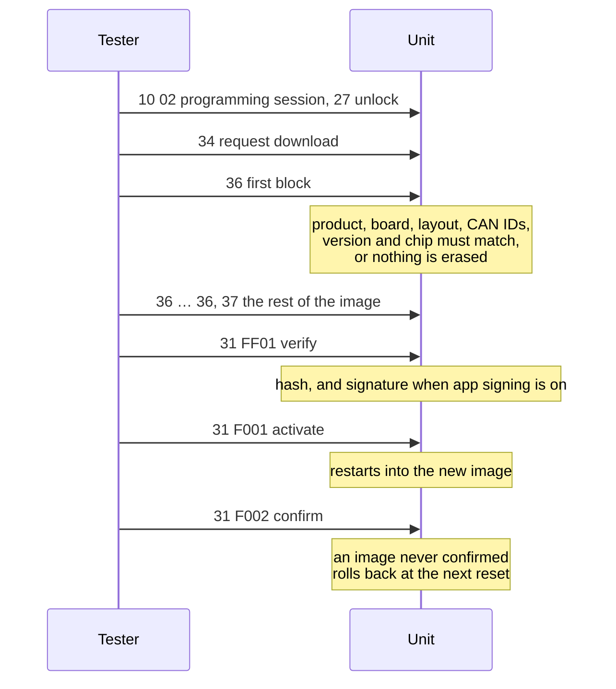

# udsota

[](https://github.com/ramb0t/udsota/actions/workflows/ci.yml)
[](https://github.com/ramb0t/udsota/releases/latest)
[](LICENSE)

**Firmware updates over UDS on CAN, built so a failed update never bricks a unit.** Every image is checked before
anything is erased, verified before it boots, and on an A/B unit rolled back if it never confirms itself.

Any UDS tester can drive an update, and the `udsota` client does it in one command. The device side is plain C on
[iso14229](https://github.com/driftregion/iso14229): an ESP-IDF component for A/B units, and a bootloader core for
microcontrollers with one app slot. Both speak the same [wire contract](docs/wire.md), so one client updates them all.

```sh
udsota --profile my.toml flash --compress app.bin
```

## What's in the box

| | For | Status |
|---|---|---|
| **The component**: `udsota.c` on iso14229 | ESP32 apps with two OTA slots. The update lives inside the app's own UDS server | Released |
| **[`boot/`](boot/README.md)**: the bootloader core, with a [reference port for STM32F1](boot/ports/stm32f1/README.md) | Microcontrollers with one app slot, where a small resident bootloader is the UDS server | Experimental: on a product's bench, not yet in the field |
| **[`client/`](client/README.md)**: the `udsota` command | Linux with SocketCAN: flash, inspect, confirm, reset, read faults, write config | Released |

## How an update runs

On an A/B unit:



Blocks carry the image as it is, as raw DEFLATE, or, where the app opts in, as a delta from the image the unit runs,
which turns a small change into kilobytes on the bus. A single-slot unit runs the same steps up to the restart; its
app then proves itself by answering, and a bootloader whose app keeps failing to start holds itself for the next
update. [docs/wire.md](docs/wire.md) has every byte, and the sequence for a flasher other than the client.

## Start

**Try it with no hardware.** The host build runs udsota and the bootloader core as Linux processes, and the client's
tests drive them over a frame pipe:

```sh
cmake -S . -B build && cmake --build build -j && ctest --test-dir build
pip install "./client[diff]" pytest && python -m pytest client/tests
```

**Add it to an ESP32 app.** The repository root is the ESP-IDF component: link it into your project as
`components/udsota` and give udsota two calls in the iso14229 server your app already owns.

```c
#include "udsota.h"

UDSOTA_IMAGE_DESC(1, 1, 0x7E6, 0x7EE);   // this image's identity: hw_id, partition layout, request and response IDs

void app_main(void)
{
    udsota_init(&(udsota_cfg_t){ .key_pubkey = pubkey, .key_pubkey_len = sizeof pubkey });
    // start iso14229 as before, and call udsota_poll(&srv) after every UDSServerPoll
}

static UDSErr_t on_event(UDSServer_t *srv, UDSEvent_t ev, void *arg)
{
    UDSErr_t rc;
    if (udsota_event(srv, ev, arg, &rc)) {
        return rc;                        // an update's request: udsota answered it
    }
    // your own services: DIDs, routines, DTCs
}
```

Then five things, each of which matters. Call `udsota_poll` after every `UDSServerPoll`, or iso14229's timers wrap
after 24.86 days. Set `srv.p2_ms = 5` after `UDSServerInit` (Known limits says why). Turn on
`CONFIG_BOOTLOADER_APP_ROLLBACK_ENABLE` with two OTA slots. Choose the `27` keys: with `key_pubkey` the tester signs
each seed and the unit holds only the public key (`udsota keygen` makes the pair); with `key_label` and `key_master`
each unit's key derives from a master; with neither, anything on the bus can update the unit. And turn on ESP-IDF's
app signing, so the verify step refuses an image you did not sign.

[`examples/esp32`](examples/esp32/README.md) is the smallest complete app, and
[`examples/candash_ws43`](examples/candash_ws43/README.md) a real product's. `udsota.h` documents the hooks you may
want: `udsota_busy()`, a `gate` that refuses an update's steps (while the vehicle moves, say), and
`udsota_end_session()`. Coming from udsota 0.14's own server, [MIGRATING.md](MIGRATING.md) takes you across.

**Use a single-slot microcontroller.** The bootloader core is the unit's UDS server while the app is not running, and
a product completes it with a port of a few flash, CAN and reset functions. [`boot/README.md`](boot/README.md) is the
porting guide, and STM32F1 parts with bxCAN can start from the reference port. The client drives it with
`[update] flow = "bootloader"`.

**Use the client.** `pip install ./client`, write a profile for your unit, then `udsota --profile my.toml info`. The
[client page](client/README.md) has every command and the profile's keys.

## Versions

On the ESP-IDF component, a unit takes a release (a clean `X.Y.Z` in `PROJECT_VER`) only when it is newer than the
one it runs, and a dev build (anything with a suffix) when its `X.Y.Z` is at least the running one's.
`cfg.allow_downgrade` lifts that rule for a dev unit; leave it off in a release build. The bootloader core has no
version rule.

## Known limits

No download resumes: one that is cut off starts again, and a lost positive answer to a `36` or `37` fails the run, so
run `flash` again. A delta needs the base to be the very `.bin` that was flashed, so keep each signed `.bin` exactly
as flashed ([why](docs/wire.md#delta-downloads)). No run has used flash encryption. A unit that boots its factory app
takes no download until an OTA slot boots, and says so in its log.

A `27` seed comes from the hardware RNG as it stands: true random while Wi-Fi or Bluetooth runs, or once the app calls
`bootloader_random_enable()` (which an app using the ADC, or I2S on an ESP32, must not), and otherwise mixed only from
the chip's secondary entropy source, which an ESP32 lacks.

The rest come from using iso14229 as it is, and [docs/iso14229.md](docs/iso14229.md) has them in full. Build
`iso14229.c` with `-fwrapv`, as the component does and an app with its own copy must too, or a transfer fails once
every 71.6 minutes of uptime. iso14229 spaces its answers by `srv->p2_ms`, 50 ms unless the app sets it, which is
why the examples set 5. A tester keeps a session alive with `3E`, which the client does. While a job answers 0x78,
iso14229 reads no other request.

## Where everything is

| Path | What it is |
|---|---|
| `udsota.c`, `udsota.h` | The updater, and its API |
| `udsota_esp.c` | Its ESP-IDF platform; `udsota.h` ends with the functions a port to another MCU supplies |
| `udsota_wire.h`, `udsota_image.h` | The wire contract as C with no `#include`, for a bootloader or tester to take alone, and the image descriptor and bare header as C types |
| `udsota_app.h` | The app's side of a [`boot/`](boot/README.md) bootloader, header-only |
| [`boot/`](boot/README.md) | The bootloader core, its porting guide and [`ports/stm32f1/`](boot/ports/stm32f1/README.md) |
| [`client/`](client/README.md) | The `udsota` command and its tests |
| [`docs/`](docs/wire.md) | [`wire.md`](docs/wire.md), the wire contract; [`iso14229.md`](docs/iso14229.md), how udsota sits in the server |
| [`examples/`](examples/esp32/README.md) | [`esp32`](examples/esp32/README.md), the smallest app; [`candash_ws43`](examples/candash_ws43/README.md), a product's, with its [bench results](examples/candash_ws43/BENCH.md) |
| `test/`, `tools/` | The host tests, the fuzzer and the two Linux servers; the release tool, the image checker and the Cortex-M3 size gate |
| `iso14229/`, `detools/` | Vendored and unmodified, each checksummed in CI ([THIRD_PARTY.md](THIRD_PARTY.md)) |

## Build and test

The two commands under Start build and test everything a host can. CI ([`ci.yml`](.github/workflows/ci.yml)) adds
clang, the end-to-end tests on a virtual CAN bus, the ESP-IDF builds of both examples with every warning an error, the
image rules on every example image, and the bootloader core on Cortex-M3 under a size gate, with its STM32F1 port
compiled beside it (`cmake --build build --target udsota_boot_arm_size`, with arm-none-eabi-gcc).

What changed in each release is in the [changelog](CHANGELOG.md), and [MIGRATING.md](MIGRATING.md) says what a
product does to move between them. [RELEASING.md](RELEASING.md) is how a release is cut. MIT licence.
