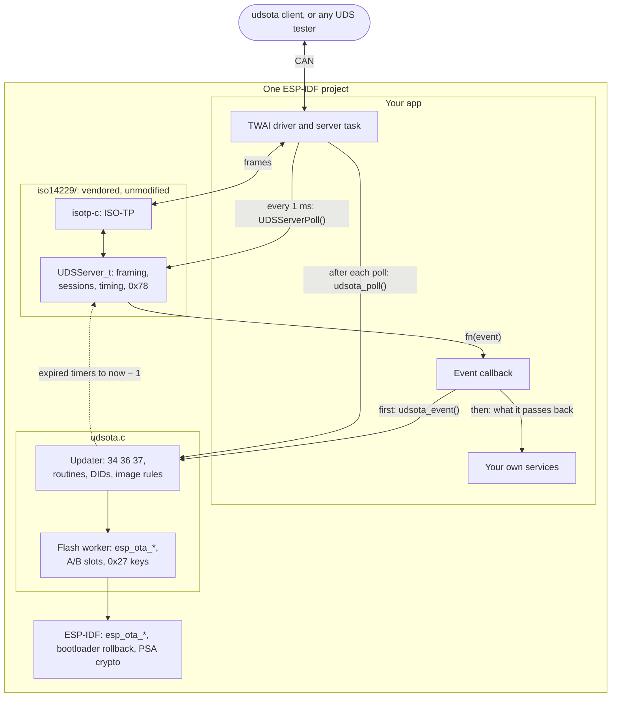

# udsota on unmodified iso14229

How udsota sits inside an app's iso14229 UDS server, the limits that follow from leaving iso14229 as it is, and every piece of the server's state udsota sets. An app integrator needs it once; each limit is a candidate for an upstream fix.

## How it fits together

Flash work runs on the worker task while iso14229 answers 0x78, and each block erases only the sectors it writes, so the erase is spread over the download.

## Limits

- S3 restarts only on `10` and `3E`, not on every request, so a tester keeps a session with `3E`; the client sends one before any request or 0x21 retry that comes over 2 s after the last `10` or `3E`. During udsota's own flash job the tester waits on 0x78s and can't send one, so udsota holds the session itself, for up to 90 s.
- While any job answers 0x78, udsota's or the app's, iso14229 reads no other request. Only the last request sent meanwhile is answered, after the job ends, where 0.14's server answered each with 0x21. An app's own 0x78 job gets no S3 hold, so the app restarts `srv->s3_session_timeout_timer` on each pass of its job, as udsota does for its own.
- `27` gets no 0x78, because iso14229 counts a pending answer as a failed key. A P-256 signature takes about 0.45 s to check on an ESP32-S3, past P2, so the client waits up to 2 s for that answer.
- A lost positive answer to a `36` or `37` fails the run, and the next run starts from the first byte. The resent `36` gets 0x24, which ends the transfer, and the resent `37` gets 0x70, which the client doesn't take as the first one's success.
- The answer to `10` carries iso14229's client defaults, P2 150 ms and P2* 1500 ms. udsota raises that P2* to the server's own (5000 ms), because the server's 0x78s come every 1.5 s and would race 1500 ms.
- iso14229 holds each answer until at least `srv->p2_ms` after the previous one (`p2_timer`, iso14229.c:2829-2851): it uses P2, which ISO 14229-2 defines as the *maximum* time a server may take to start answering, as a *minimum* gap between answers, and the standard asks for no such gap on ordinary (non-0x78) answers. At iso14229's 50 ms default (`UDS_SERVER_DEFAULT_P2_MS`) a multi-frame answer behind a CAN frame-rate cap can pass the client's 150 ms P2: a 6-frame `22 F1F3` under a 50 frames/s cap ended at about 155 ms on the ws43b. **The examples and the e2e server set `s_srv.p2_ms = 5` right after `UDSServerInit`** — server state the app is free to set — which brings that case to about 110 ms while leaving a token rate limit, and an integrator should do the same. udsota's ActivateImage reset delay is `p2_ms + 60 ms` and stays correct at the lower value, because the answer and the reset both derive from `p2_ms`. Dropping the gate on ordinary answers is the upstream candidate.
- ISO-TP frames are not padded, and N_Bs and N_Cr are 100 ms. Compile definitions `ISO_TP_FRAME_PADDING` and `ISO_TP_DEFAULT_RESPONSE_TIMEOUT_US=1000000` change both without touching iso14229's code. In an ESP-IDF project they go in the `COMPILE_DEFINITIONS` build property; `idf.py -D` sets CMake variables, not these.
- isotp-c's timer check subtracts as `int32_t`, which overflows each time its 32-bit µs clock passes 2³¹, every 71.6 minutes. At -O1 and above, GCC and Clang fold it to a compare that ends a transfer in flight with a false N_Bs or N_Cr timeout. The component compiles `iso14229.c` with `-fwrapv`, a build flag rather than a change to iso14229, and `test_isotp_wrap`, built at -O2, fails without it. An app that builds its own copy of iso14229 needs the flag too.

**Uptime past 24.86 days.** iso14229 compares its millisecond deadlines as signed 32-bit differences, which read an expired deadline as pending again once it is 2³¹ ms (24.86 days) old. `udsota_poll` keeps them younger than that. An app that doesn't call it after every `UDSServerPoll` meets both failures. A request that comes more than 24.86 days after the server's last answer, or after `UDSServerInit` if it has answered nothing, gets its answer only 49.71 days after that, and nothing else is read meanwhile. From 24.86 to 49.71 days after `UDSServerInit`, or after a failed key, every `27` gets 0x37, or 0x36.

## What udsota sets in iso14229

udsota never changes iso14229's code. Where iso14229 has no call for what an update needs, udsota sets the server's state itself, here and nowhere else:

- `securityLevel` and `xferIsActive`, cleared on every accepted `10 01/02/03` and S3 timeout, and `sessionType` too when udsota ends a session: its own, or the app's through `udsota_end_session`.
- `xferTotalBytes`: a raw-DEFLATE or delta download's byte limit, raised to the stream's bound, because iso14229 counts the bytes against memorySize, the image's size.
- `ecuResetScheduled` and `ecuResetTimer`: the restart after ActivateImage, at least 60 ms after its answer. Unlike iso14229's own `11 01`, it keeps reading requests until then.
- `s3_session_timeout_timer`, during udsota's own flash job.
- `p2_timer`, `sec_access_boot_delay_timer` and `sec_access_auth_fail_timer`, in `udsota_poll`: each that has expired moves to now − 1 on every pass, which still reads as expired, so none gets old enough to wrap.
- In event arguments, as iso14229 provides: the `10`'s `p2_star_ms`, raised to the server's P2*, and `maxNumberOfBlockLength` in udsota's own `34`s.
